  <!-- Hero Banner SVG -->
  

  <!-- Animated Typing Tagline -->
  

    
  

  <!-- Quick Status Badges -->
  

    
    
    
    
  

<!-- ABOUT ME & DEVELOPER SPOTLIGHT -->
<table>
  <tr>
    <td width="62%" valign="top">
      <h3>⚡ About Me // System Diagnostic</h3>
      

        I'm <b>Shounak Saha</b>, an Integrated B.Tech–M.Tech scholar in <b>Computer Science & Engineering (Specialization in Cybersecurity)</b> at the prestigious <b>National Forensic Sciences University (NFSU)</b>.
      

      <ul>
        <li>🛡️ <b>Cybersecurity & Forensics:</b> Investigating attack vectors, digital forensics, threat intelligence, memory/network analysis, and hardened system design.</li>
        <li>🧠 <b>Autonomous AI & Agentic Workflows:</b> Architecting agent benchmarking environments (<code>ai-office-simulator</code>) and multi-modal synthetic media forensics (<code>deepfake-detection-lab</code>).</li>
        <li>🌐 <b>Full-Stack Systems:</b> Crafting high-performance web applications with Next.js 15, TypeScript, TailwindCSS, Zustand, and real-time WebGL rendering engines.</li>
        <li>🏛️ <b>GovTech & High-Stakes Tech:</b> Creator of <b>PRAVAH Command</b> — a multi-source hydrological early warning and disaster response coordination dashboard for NDRF & DDMA (Smart India Hackathon).</li>
        <li>🏏 <b>Sports Analytics & Simulation:</b> Designed a deterministic SplitMix64 PRNG cricket simulation engine with WebGL field visualizer.</li>
        <li>💡 <i>"Simplicity in architecture, elegance in code, zero compromise on security."</i></li>
      </ul>
    </td>
    <td width="38%" align="center" valign="middle">
      
       
      <b><code>root@shounak:~$ status --active</code></b>
    </td>
  </tr>
</table>

<!-- FEATURED PROJECTS SHOWCASE -->
<h2 align="center">🚀 Featured Missions & Architectures</h2>

| Project | Tech Stack | Highlights & Architecture | Links |
| :--- | :--- | :--- | :---: |
| 🌊 **PRAVAH Command** | `React 19` `TypeScript` `Leaflet GIS` `Zustand` `Tailwind` | Multi-source hydrological early warning & disaster response coordination dashboard for **NDRF & DDMA** (SIH 2026). Real-time telemetry, catchment basin runoff & tactical resource allocation. | [**Code**](https://github.com/ShounaksHub/pravah_flashflood_safety) |
| 🤖 **AI Office Simulator** | `Python` `OpenEnv` `Hugging Face` `Docker` | OpenEnv-compliant environment for evaluating autonomous AI agents on real-world office tasks (email handling, triage, step-wise rewards, multi-level tasks). | [**Code**](https://github.com/ShounaksHub/ai-office-simulator) |
| 🔍 **Deepfake Detection Lab** | `Python` `Next.js` `FastAPI` `PyTorch` `Vercel` | Multi-modal deepfake detection and forensics suite analyzing visual and acoustic anomalies to flag synthetic manipulation. | [**Code**](https://github.com/ShounaksHub/deepfake-detection-lab) • [**Live App**](https://deepfake-detection-lab.vercel.app) |
| 🏏 **Cricket Dream XI** | `Next.js 15` `PixiJS 8` `Turborepo` `Prisma 6` `NestJS` | High-fidelity browser cricket game powered by deterministic **SplitMix64 PRNG**, official MCC Laws 2026, 1,144 player database, and WebGL field rendering. | [**Code**](https://github.com/ShounaksHub/Cricket-Game) |
| 🗳️ **BallotBuddy** | `Next.js` `Google Gemini SDK` `Firebase` `Zod` | Neutral, conversational civic education assistant powered by official `@google/genai` unified SDK, safety guardrails, and Firebase hosting. | [**Code**](https://github.com/ShounaksHub/BallotBuddy) |
| ⛓️ **CredChain** | `TypeScript` `Web3` `Cryptography` `Vercel` | Decentralized tamper-evident credential issuance and verification protocol built for verifiable academic & institutional records. | [**Code**](https://github.com/ShounaksHub/CredChain) • [**Live App**](https://cred-chain-zeta.vercel.app) |
| 🎬 **ViralCut AI** | `Python` `AI/ML` `FFmpeg` `Automation` | Automated AI video intelligence pipeline for extracting highlights, captions, and viral short-form clips. | [**Code**](https://github.com/ShounaksHub/viralcut-ai) |

<!-- TECH STACK & WEAPONS MATRIX -->
<h2 align="center">🛠️ Weapons of Choice & Technical Arsenal</h2>

### 💻 Core Programming Languages

  
  
  
  
  
  
  

### 🛡️ Cybersecurity & Digital Forensics

  
  
  
  
  
  
  

### 🧠 Artificial Intelligence, Agents & Data Science

  
  
  
  
  
  
  
  

### 🌐 Full-Stack, WebGL & Frameworks

  
  
  
  
  
  
  
  
  

### ☁️ DevOps, Cloud & Environments

  
  
  
  
  
  
  

<!-- GITHUB LIVE STATS & TELEMETRY -->
<h2 align="center">📊 GitHub Telemetry & Live Analytics</h2>

  <table border="0">
    <tr>
      <td align="center" valign="middle">
        
      </td>
      <td align="center" valign="middle">
        
      </td>
    </tr>
  </table>

   

  

 

<!-- CONTRIBUTION SNAKE -->

  <h3>🐍 Contribution Grid Snake</h3>
  <picture>
    <source media="(prefers-color-scheme: dark)" srcset="assets/github-contribution-grid-snake-dark.svg">
    <source media="(prefers-color-scheme: light)" srcset="assets/github-contribution-grid-snake.svg">
    
  </picture>

<!-- DEV HUMOR & WISDOM SECTION -->
<h2 align="center">💡 Dev Humor & Neural Terminal</h2>

  <table>
    <tr>
      <td width="35%" align="center">
        
         
        <i>Pushing code at 3 AM...</i> ☕
      </td>
      <td width="65%" align="center">
        
      </td>
    </tr>
  </table>

<!-- CONNECT & SOCIALS -->
<h2 align="center">🛰️ Establish Uplink // Connect With Me</h2>

  Whether you want to discuss <b>Cybersecurity, AI Agent Architecture, Sports Analytics</b>, or explore potential collaborations — my inbox is always open!

  
  
  

 

<!-- FOOTER WAVE BANNER -->

  
  

    Crafted with 💜 and ☕ by <b>Shounak Saha</b> • © 2026
  

